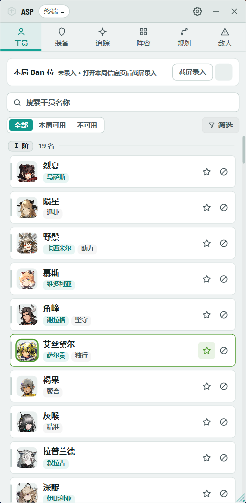
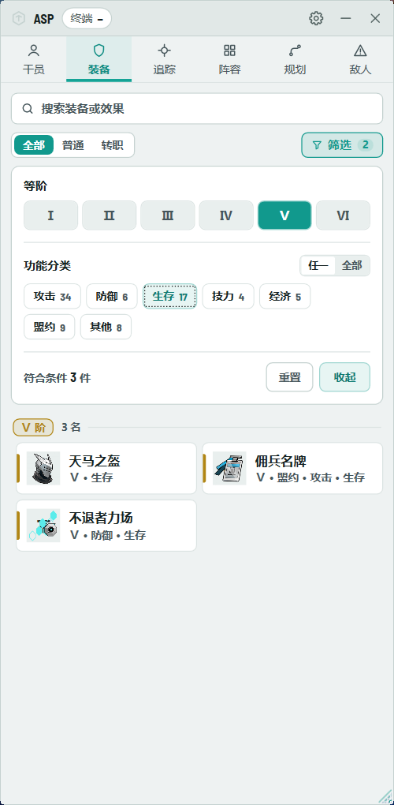
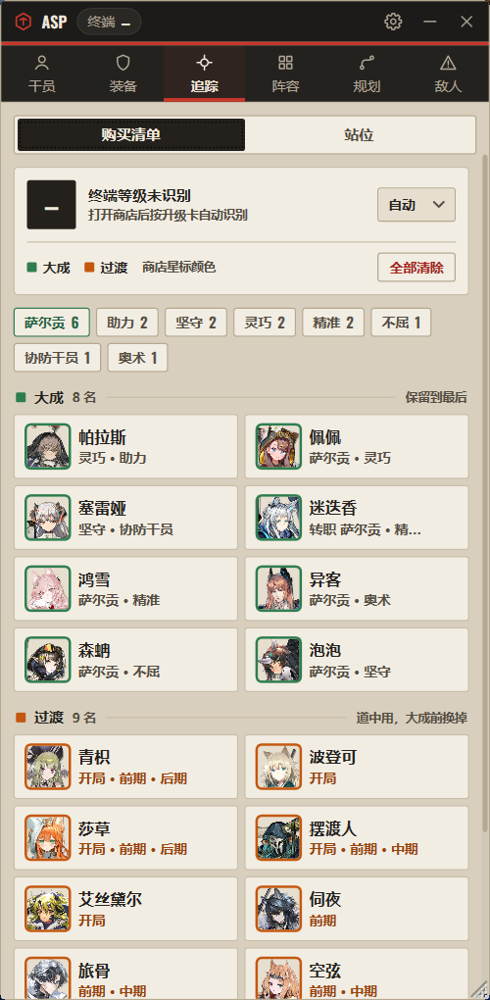
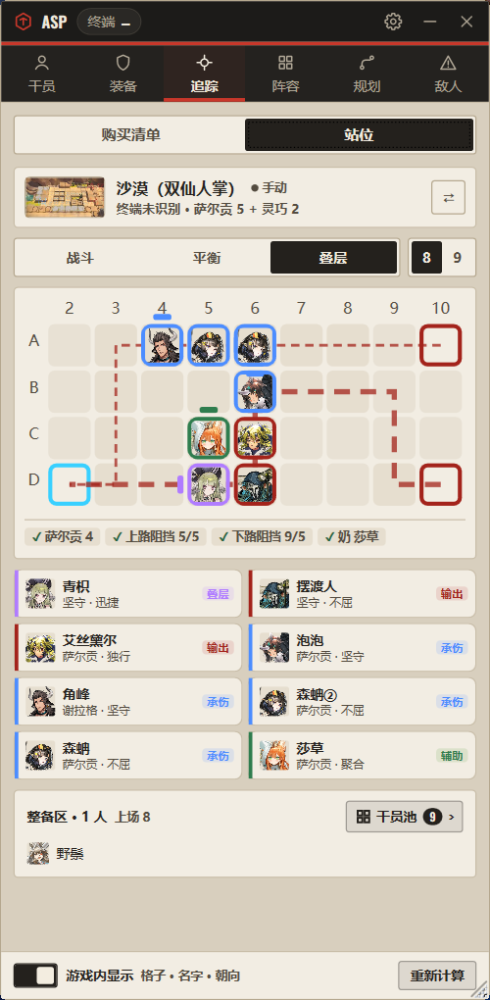
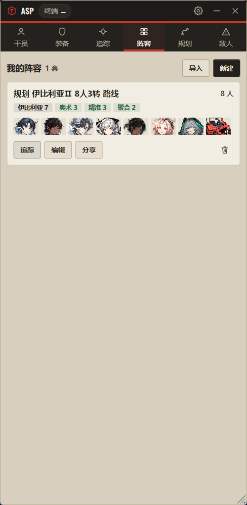
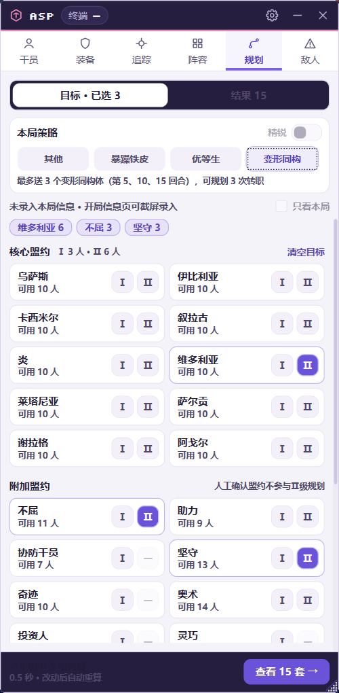
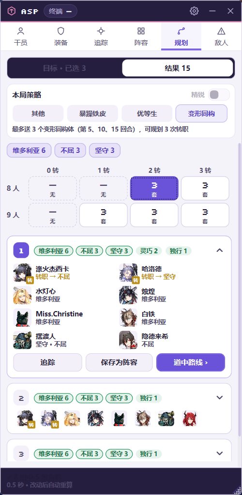
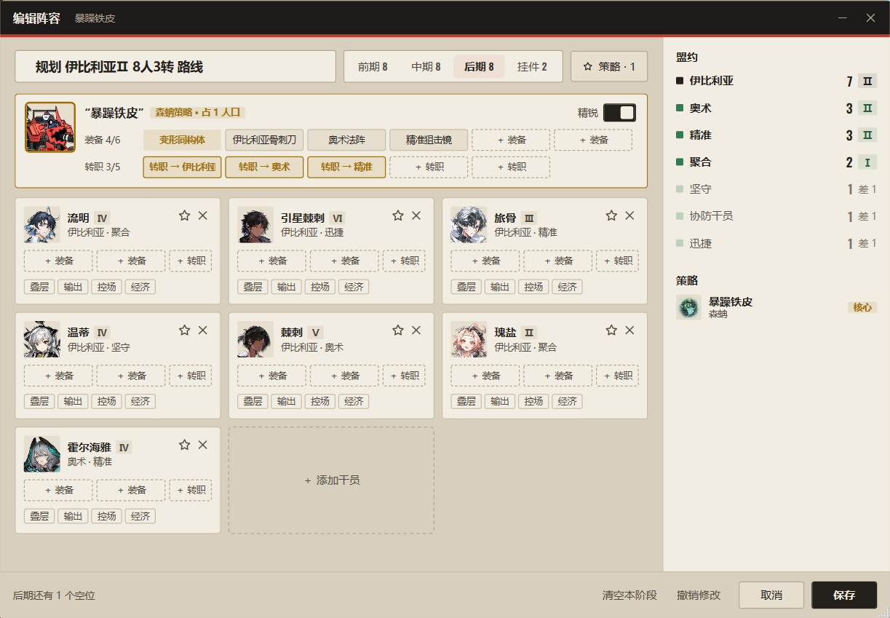

<div align="center">
  
  <h1>ASP Assistant · Arknights</h1>
  <p>明日方舟·卫戍协议 辅助工具<br/>基于 Moonfair/ASP_Assistant 修改，由 MaaFramework 提供图像识别能力。</p>
  <p>
    
    
    
    <a href="LICENSE"></a>
  </p>
  <p><a href="https://github.com/Moonfair/ASP_Assistant">原项目</a> · <a href="https://github.com/bingyunhe/asp-assistant-arknights/issues">问题反馈</a></p>
</div>

---

> **项目来源**：本项目是在 [Moonfair/ASP_Assistant](https://github.com/Moonfair/ASP_Assistant) 基础上修改的独立衍生版本，保留原项目 Apache License 2.0 协议与归属声明。感谢 Moonfair 及上游贡献者。本仓库不是原作者发布的版本。
>
> 上游基线：[`93b2ba8`](https://github.com/Moonfair/ASP_Assistant/commit/93b2ba8514f6591a67e4cbf5a6169dee7d065bf6)。本次修改日期为 **2026-11-09**；改动范围见各文件头部声明。

## 目录

- [简介](#简介)
- [截图](#截图)
- [快速开始](#快速开始)
- [功能](#功能)
  - [识别](#识别)
  - [查询](#查询)
  - [追踪与阵容](#追踪与阵容)
  - [规划](#规划)
  - [设置与窗口](#设置与窗口)
- [连接 MuMu / ADB](#连接-mumu--adb)
- [当前数据与限制](#当前数据与限制)
- [开发](#开发)
- [致谢](#致谢)
- [许可证](#许可证)

## 简介

ASP Assistant · Arknights 是《明日方舟》卫戍协议的辅助工具，以侧边栏的形式贴在游戏窗口旁运行。它读取游戏画面，帮你录入本局信息、在商店里标出追踪目标，并提供干员 / 装备查询、阵容管理、阵容规划和站位规划。

当前版本 **v1.7.1**，支持 PC 客户端和 MuMu 模拟器（ADB）。

| 页面 | 能做什么 |
| --- | --- |
| 干员 | 按等阶、盟约、词条筛选干员，悬停看普通 / 精锐详情；截屏录入本局 Ban 位 |
| 装备 | 按等阶、功能分类筛选装备，普通 / 精锐数值合并对比 |
| 追踪 | 购买清单：商店刷出目标时标绿色星号；站位：识别地图，给出每个人的格子和朝向 |
| 阵容 | 保存、编辑、分享阵容，按前期 / 中期 / 后期分阶段规划 |
| 规划 | 选盟约目标，自动搜索 8 / 9 人、0–3 次转职的候选阵容和道中路线 |
| 敌人 | 自动识别本局敌方领袖和特训敌人，查看资料 |

## 截图

截图不含账号信息，三套界面主题（卫戍协议终端、乌萨斯齐心团、“全能的”可露希尔）都有展示。

| 干员 | 装备 | 追踪 · 购买清单 |
| :---: | :---: | :---: |
|  |  |  |

| 追踪 · 站位 | 阵容 | 规划 · 目标 | 规划 · 结果 |
| :---: | :---: | :---: | :---: |
|  |  |  |  |

<div align="center">
  
  <p>阵容编辑器：按前期 / 中期 / 后期编辑干员、装备与转职，右侧实时统计盟约</p>
  
  <p>干员悬停详情：同时显示普通与精锐</p>
</div>

## 快速开始

1. 从 [Releases](https://github.com/bingyunhe/asp-assistant-arknights/releases/latest) 下载 `ASPAssistant-v1.7.1-win-x64.zip`（不要下 `Source code`，那是源码）。
2. 右键「全部解压」到一个单独的文件夹，保留 `data`、`runtimes` 等全部文件。
3. 双击 `ASPAssistant.App.exe`。无需另装 .NET，识别模型和运行库都在包里。
4. 首次启动时选择游戏里正在用的模式主题；之后可在右上角设置里修改。
5. 用模拟器玩的话，在设置的「游戏连接」里切换到 MuMu / ADB，见 [连接 MuMu / ADB](#连接-mumu--adb)。

**更新**：程序会自动检查本仓库的 Releases。手动更新时先退出旧程序，再解压新版；追踪、阵容等个人设置在本机用户数据目录，不会被覆盖。

**校验下载**：发布页提供 `SHA256SUMS.txt`，可用 `Get-FileHash .\ASPAssistant-v1.7.1-win-x64.zip -Algorithm SHA256` 核对；`PACKAGE-MANIFEST.txt` 记录 CI 解包检查后的版本、资源数量和 ZIP 哈希。各版本改动见 [发行说明](RELEASE_NOTES.md)。

**运行要求**

| 条件 | 说明 |
| --- | --- |
| 系统 | Windows 10 / 11，x64 |
| 游戏 | 明日方舟 PC 版，或 MuMu 中的 Android 12 / 15 版 |
| 画面 | 16∶9；识别仍受赛季界面和分辨率影响 |
| 运行库 | 发布包已带齐；源码构建的非独立版本需要 [.NET 8 Desktop Runtime](https://dotnet.microsoft.com/download/dotnet/8.0) 和 VC++ 2015–2022 x64 运行库 |

## 功能

### 识别

**开局信息与 Ban 位**
- 打开开局信息页时自动录入核心盟约、附加盟约、Ban 位和敌人；也可以点「截屏录入」或用快捷键，开局后从游戏内重新打开信息页也能录。
- 缩放、最小化、失焦或标题漏读不会重复触发自动录入；看到明确的对局画面后才会准备识别下一局。
- 游戏被其他窗口挡住且不在前台时暂停截屏；截图时会短暂隐藏侧栏和叠加层，避免挡住画面。
- 识别失败只提示、保留旧结果；盟约和敌人分开校验，敌人没认出来不影响盟约录入。

**本局敌人**
- 进入「确认本局信息」时自动读取右侧的敌方领袖和特训敌人，也可以在敌人页手动重试。
- 支持首领名称断行、相邻特训类型合并去重；未收录的敌人保留识别文字并提示缺少资料，不会套用名字相近的其他敌人。

**商店追踪标记**
- 商店名称栏同时识别追踪中的干员和装备，在目标名称上方标绿色星号；按实际名称位置定位，已售空的格子不影响其他格。
- 灰色卡、冻结、金色扫光都能识别。装备金光表示可升精锐；角色金光也可能只是已持有同名角色，本工具不据此判断三连或升级。
- 不同模式主题的名称栏位置和图像处理不同，请在设置里选对主题。

**站位地图**
- 识别当前卫戍协议地图（10 张，商店收起 / 展开两种镜头），场上站满干员也能认出；暂时看不到棋盘时沿用上次的地图，也可以手动选图。

### 查询

**干员**
- 按等阶、核心盟约、其他盟约、词条类型、触发时机和本局状态筛选，支持名称搜索。
- 同一行的盟约默认满足任一即可，勾选「同时选中」后要求全部满足；不同行之间始终同时满足。
- 列表显示头像、名称和盟约，鼠标悬停同时显示普通和精锐信息；可直接追踪或标记禁用。
- 录入本局信息后高亮本局可用盟约，「清除高亮」不影响筛选和禁用标记。

**装备**
- 按等阶、功能分类（攻击、防御、生存、技力、经济、盟约、其他）以及普通 / 转职装备筛选；一件装备可属于多类，分类由项目手工维护。
- 普通和精锐数值合并显示，例如 `攻击力+15(25%)%`：高亮的 `15` 是普通值，括号内是精锐值；效果说明不同的（如「博士投影」的生效时机）分别列出。
- 没有精锐版本时显示「无精锐装备」；转职装备显示对应盟约。

### 追踪与阵容

**追踪列表（购买清单）**
- 把干员、装备加入追踪，或从保存的阵容 / 规划结果一键导入；按大成和过渡分组，过渡干员标出所在阶段。
- 设置里打开「同时追踪多个队伍」后，连续追踪的阵容会合并去重；关闭时下次追踪会替换当前列表。
- 计划转职随阵容和追踪保存，追踪页的目标盟约分布包含转职与调和加成。
- 右键追踪目标可「标记已获取」：保留在列表里，但不再在商店标出、不计入盟约分布；再次右键或重新追踪即恢复。
- 顶部显示终端等级，过了的阶段不再标出对应的过渡干员。

**阵容**
- 保存、编辑、导入 / 分享阵容；编辑器按前期、中期、后期分阶段，每人可配装备、转职和标签，右侧实时统计盟约档位。
- 支持策略（如暴躁铁皮、变形同构）和精锐切换；编辑器、选择干员等对话框可最小化。

### 规划

**阵容规划**
- 选择核心或附加盟约的 Ⅰ / Ⅱ 档目标和本局策略，按 8 / 9 人、0–3 次转职分别搜索候选阵容，可固定必须加入的干员。
- 与本局 Ban 位联动；打开「只看本局」后只用本局可用盟约，被禁的附加盟约仍可由原生干员凑人数，但不能作为转职目标。
- 候选显示转职目标、调和加成和空位，可直接保存为阵容、加入追踪，或展开道中路线。
- 需要叠层、精锐等额外条件的 Ⅱ 档会标注，规划只保证人数；达到搜索上限时会提示，没找到不代表无解。
- 感谢 CarlosDJY（Jiayu Ding）通过 [PR #1](https://github.com/bingyunhe/asp-assistant-arknights/pull/1) 贡献阵容规划等功能。

**站位规划（实验）**
- 在追踪页顶部切到「站位」。从干员池里挑 8 / 9 人上场，给出每个人的格子和朝向，其余放整备区。
- 打分考虑两条敌人路线的拦截点、纵深（重装在前、远程在后）、奶的覆盖、阻挡数和地块效果（红地板、沼泽、蓝箭头、城区、宫殿），并保证至少一个奶上场。
- 计入与位置有关的叠层特质（身前 / 身后、周围、同一行、攻击范围内）、塞雷娅复制特质、涤火杰西卡（按满层）、整备区也生效的干员和盟约激活。
- 小棋盘显示头像，可拖动换位，或「固定在这里」后围绕他重新规划；同名干员可重复上场（盟约只按不同干员计数）。检查项区分硬要求（✓ / ✗）和地块提示。
- 干员池：追踪的大成 / 过渡干员默认灰色，点亮即已拥有；扩展池按阶数列出与阵容共享盟约的其他干员；可手动添加、标精锐、设同名数量。
- 「游戏内显示」默认关闭，打开后在游戏画面上标出格框、朝向和名牌。
- 打分权重是估计值，不是游戏数值；阿戈尔吞噬、雪原隐匿格和飞行敌人尚未纳入，结果仅供参考。

### 设置与窗口

- 右上角齿轮打开设置：模式主题（卫戍协议终端 / 乌萨斯齐心团 / “全能的”可露希尔）、侧栏外观、截图来源、多队伍追踪、侧栏位置和更新检查，改完立即生效并保存。
- 侧栏可置顶、拖动和缩放，默认吸附在游戏窗口旁；游戏最小化时侧栏和标记一起隐藏，恢复时一起恢复。
- 界面字体内置 Noto Sans SC，不依赖系统字体。
- 自动更新只读取本仓库的 Releases，校验 `SHA256SUMS.txt` 后同盘替换目录，失败时尝试回滚并显示原因；版本号为 0.0.0 的开发构建不检查更新。

## 连接 MuMu / ADB

1. 在 MuMu 中打开明日方舟，画面设为横屏 16∶9（支持 1920×1080 和 1280×720，240 DPI，平板模式）。
2. 打开设置，在「游戏连接」卡片上点「更改…」，选择 **MuMu / ADB**。
3. 点「发现设备」，在列表里选中正在运行游戏的实例；找不到时展开「手动填写」，填 `adb.exe` 路径和连接地址。
4. 在「游戏窗口」里选对应的 MuMu 窗口（多开时注意实例和窗口要对上），点「测试并应用」。
5. 读到画面后状态条会显示分辨率和缩略图，再点「应用」即可。之后改了任何设置都需要重新测试。

ADB 模式用 MaaFramework 后台截图，游戏被其他窗口挡住也能识别。设置里的游戏连接卡片会显示当前状态：断开时变红并每 5 秒重试，按钮变成「重新设置…」。连接设置保存在本机，原有安装默认仍用 PC 截图。

目前实测过 MuMu 12、1920×1080、终端主题的商店识别；ADB 模式不接受竖屏和非 16∶9 画面。其他商店等级、主题和模拟器版本还需要更多实机验证。

## 当前数据与限制

| 项目 | 状态 |
| --- | --- |
| 数据赛季 | 卫戍协议·规程·序列 I，`act3autochess` / `V3_1` |
| 干员 / 装备 / 盟约 | 141 / 70 / 26 |
| 核心转职盟约 | 从游戏表 `giveBondId` 生成映射；其他转职盟约沿用名称匹配 |
| Ban 位识别 | 单张截图结合图标亮灰与 OCR 名称吸附，支持合并名称拆分；未命名图标会报告，仍受画面布局影响 |
| 商店追踪识别 | 三款主题共 14 张 1080p 实拍脱敏图，覆盖一本四格、二本五格、四本六格、灰色、冻结、扫光、重复干员和售空；720p 与超宽留边用合成图验证，原生超宽屏、其他 DPI 及终端 / 乌萨斯六本待实测 |
| 站位地图识别 | 10 张地图的可部署格、敌人路线与特殊地块，按格子颜色匹配地图与镜头；已用实拍截图验证，MuMu 下尚未实测 |
| 场上与备战区干员识别 | 尚未实现，站位规划使用干员池中手动点亮的干员 |
| 首领 / 敌人 | 右侧区域识别已通过两张 1080p 实拍图验证；资料尚未完整同步本赛季，未收录内容单独提示 |

## 开发

### 从源码构建

安装 .NET 8 SDK 后，在 PowerShell 中运行：

```powershell
git clone https://github.com/bingyunhe/asp-assistant-arknights.git
cd asp-assistant-arknights
dotnet restore ASPAssistant.sln
dotnet test src/ASPAssistant.Tests/ASPAssistant.Tests.csproj -c Release
dotnet run --project src/ASPAssistant.App
```

仓库已包含当前 JSON 数据、图标和 OCR 模型，首次运行不需要重新抓取数据。

```powershell
# 需要 .NET Desktop Runtime 的本地版本
dotnet publish src/ASPAssistant.App/ASPAssistant.App.csproj -c Release --self-contained false -o publish/local

# Windows x64 独立版本
dotnet publish src/ASPAssistant.App/ASPAssistant.App.csproj -c Release -r win-x64 --self-contained true -o publish/win-x64
```

调试时可以用 `ASPASSISTANT_SETTINGS_DIR` 环境变量指定一个独立的设置目录，再用 `dotnet ASPAssistant.App.dll` 启动构建好的程序，避免影响自己的配置。

### 发布

- 提交到 `main` 或 `dev` 的 PR 会自动运行测试（`.github/workflows/pr-tests.yml`）。
- 维护者更新发行说明后，推送 `v` 开头的版本标签即触发 `.github/workflows/release.yml`：运行测试、构建独立运行包、打包运行库与许可证、生成校验文件并发布到 GitHub Releases。

### 更新游戏数据

脚本需要 Python 3.10+，处理图片需要 Pillow。

```powershell
python -m pip install Pillow
cd data
# 只更新本赛季干员、装备、盟约，保留首领和敌人数据
python fetch_spdatabase.py --skip-bosses --skip-enemies
```

| 命令 | 功能 |
| --- | --- |
| `python fetch_spdatabase.py --skip-bosses --skip-enemies` | 更新当前干员、装备和盟约数据 |
| `python fetch_spdatabase.py --download-skins` | 下载皮肤头像并重建映射 |
| `python fetch_spdatabase.py --apply-mask` | 为已有皮肤头像补白色背景 |
| `python fetch_spdatabase.py --skip-icons` | 跳过图标下载 |

已有图标会保留，只下载缺失的。数据脚本的输出格式和来源沿用原项目，并增加了当前赛季的读取逻辑；更新数据不会自动适配识别区域。

### 项目结构

```text
├── data/
│   ├── operators.json           # 干员、盟约与词条
│   ├── equipment.json           # 装备与普通 / 精锐效果
│   ├── covenants.json           # 盟约与核心转职装备映射
│   ├── skin_avatar_map.json     # 皮肤头像到干员名的映射
│   ├── garrison_maps.json       # 站位地图：可部署格、敌人路线、特殊地块与镜头
│   ├── icons/                   # 干员、装备、敌人等图标
│   ├── model/                   # OCR 模型
│   └── fetch_spdatabase.py      # 数据与图片获取脚本
├── src/
│   ├── ASPAssistant.App/        # WPF 界面
│   ├── ASPAssistant.Core/       # 业务逻辑与数据层
│   └── ASPAssistant.Tests/      # 数据、视图模型和 WPF 回归测试
├── docs/images/                 # README 截图
├── LICENSE                      # Apache License 2.0 标准正文
├── LICENSE.upstream             # 上游许可原文及版权声明
└── NOTICE                       # 上游与第三方归属
```

个人追踪、阵容、窗口和主题设置保存在本机用户数据目录，不随源码分发。请不要把个人配置、未脱敏的游戏截图、日志、密钥或构建缓存提交到仓库。

## 致谢

- [Moonfair/ASP_Assistant](https://github.com/Moonfair/ASP_Assistant)：本项目的上游代码与设计基础。
- [MaaFramework](https://github.com/MaaXYZ/MaaFramework)：OCR、模板与特征匹配，以及 ADB 截图。
- [CommunityToolkit.Mvvm](https://github.com/CommunityToolkit/dotnet)：MVVM 基础设施。
- [Noto Sans SC](https://fonts.google.com/noto/specimen/Noto+Sans+SC)：内置界面字体（子集），SIL Open Font License 1.1，许可文本随字体文件分发。
- [PRTS Wiki](https://prts.wiki/) 与 [SPDatabase](https://github.com/Yanstory/SPDatabase)：游戏数据和图片来源，具体接口保留在数据脚本中。
- xUnit、Moq、FluentAssertions 等测试依赖遵循各自的许可证。

## 许可证

本项目的修改部分以 **[Apache License 2.0](LICENSE)** 开源。`LICENSE` 采用 [Apache 官方标准正文](https://www.apache.org/licenses/LICENSE-2.0.txt)；上游仓库原许可文本的部分措辞与标准正文不同，已逐字保留于 [LICENSE.upstream](LICENSE.upstream)，其中的原始版权声明及上游许可条件继续保留。

分发源码或构建产物时，请一并保留 `LICENSE`、`LICENSE.upstream`、`NOTICE` 以及相关文件中的版权和变更声明。

软件许可证不改变《明日方舟》游戏数据、名称、图像和其他第三方资源的权利归属；各依赖遵循其各自的许可证。本项目仅供学习和个人使用，与 Hypergryph / 鹰角网络无关。
