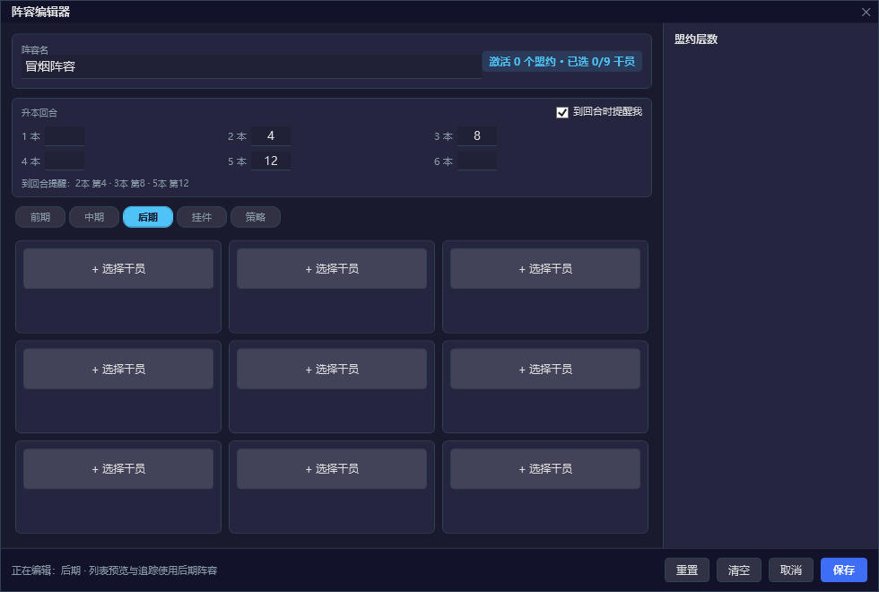

# 升本回合提醒

给「我的阵容」加了一套**分本计划**：一局最多 6 本，每本可以设一个计划回合，对局中回合数走到哪一本的回合，就提醒该升到几本。

## 怎么用

1. 阵容页 → 选中一套阵容 → 编辑。
2. 名字下面「升本回合」一行有 6 个格子，按「1 本 … 6 本」排好：想在哪一回合升到第几本，就把回合数填进对应格子（1–30）。哪一本不需要提醒就留空。
3. 右边勾上「到回合时提醒我」。
4. 保存后回到阵容列表，点「使用」，让这套阵容成为**当前使用**的那套（按钮会变成「使用中」）。
5. 对局中回合数到达某个填过的回合时，侧栏顶部弹一条 `第 9 回合：升到 3 本`，30 秒后自动收起，也可以点 × 关掉。

只有「当前使用」的那套阵容会提醒；切换阵容后提醒状态会重置，不会拿上一套的计划乱弹。

## 回合数是怎么来的

游戏画面顶部中间有一个「回合 N」的计数，程序按 1.5 秒一次的节奏截屏，用仓库自带的 PaddleOCR 模型读这一小块，只取数字。

- 读不到回合（不在对局界面）时不更新，也不提醒。
- 同一回合只提醒一次——靠回合号去重，而不是靠计时器。
- 回合数变小视为开了一局新的，提醒状态重置。
- 升级按钮已经是「已满级」时不再提醒。
- 多个本填了同一个回合时，只提醒本数最低的那一本。
- 追踪页的「游戏状态」会同步显示当前回合和是否可升级。

## 已知限制

- 回合数只有在游戏界面顶部显示计数时才读得到。商店、结算这类界面如果顶部没有「回合 N」，程序会保留最后一次读到的值，等回到对局界面再更新。
- 提醒在侧栏里，侧栏收起来的时候看不到。
- 计划是按「回合」匹配的：如果某一帧没读到回合，跳过了那个数字，那一本的提醒就错过了，不会补发。
