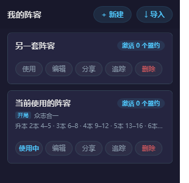

# 升本回合提醒

给「我的阵容」加了一套**升本计划**：一局从 1 本打到 6 本，1 本是进对局就有的等级，2–6 本每一本填一个**回合区间**（比如 2 本在第 4–5 回合之间升上去），对局中回合数走进某个区间，侧栏就提醒一次该升到几本、还剩几个回合。

## 怎么用

1. 阵容页 → 选中一套阵容 → 编辑。
2. 「升本计划」里 2–6 本各填一个回合区间（1 本是进对局就有的等级，不用设），范围 1–30。哪一本没打算就留空——留空不代表不能升，只是不提醒。
3. 想让程序按区间提醒，就别勾「看情况自行判断升本」；勾上表示你自己盯着回合数判断，程序不弹提醒。
4. 保存后回到阵容列表，点「使用」，让这套阵容成为**当前使用**的那套（按钮会变成「使用中」）。
5. 对局中回合数走进某个区间时，侧栏顶部弹一条 `第 9 回合：升 3 本（计划 9–12，还剩 4 回合）`，30 秒后自动收起，也可以点 × 关掉。

区间一行排开，下面一行摘要会把整套计划写成 `2本 4–5 · 3本 6–8 · …`，填反了（后面的本比前一本还早）会用橙色文字提示，但仍然按你填的存。

阵容卡片上也会带一行小字 `升本 2本 4–5 · 3本 6–8 …`，不用打开编辑器就能看到这套阵容的打算。

只有「当前使用」的那套阵容会提醒；切换阵容后提醒状态会重置，不会拿上一套的计划乱弹。

## 开局策略

阵容编辑器里还有一张「开局策略」卡片：一局只能带一个策略，它同时决定初始目标生命值（比如「众志合一 · 阿米娅」是 25 点，「坚不可摧 · 歌利亚」是 40 点）。点「选择」按名字或发起人搜，选定后卡片上会显示头像、名字、初始生命值和效果说明，`✕` 清空。

它是**开局选项**，不是一套阵容里可以同时勾的好几条：原来的实现把策略做成了编辑器里的一个页签、能塞 9 条还带「阵容核心 / 优选 / 次选」标签，和游戏里「一局选一个」的做法对不上，所以改成了单选。

阵容卡片上会用 `开局 众志合一` 这样一行标出来，方便开局前对一眼。

存储上仍然写在 `strategies` 字段的第一项里，所以旧阵容文件、别人分享过来的链接都还能读——文件里如果存了多条，只认第一条，下次保存就归一成一条。

## 提醒规则

- 勾了「看情况自行判断升本」就完全不提醒，区间只当备忘。
- 区间是闭区间：填 9–12，第 9、10、11、12 回合各提醒一次，每回合只提醒一次。
- 同一回合落在多个区间里时，只提醒本数最低的那一本（也就是计划里的下一本）。
- 回合数越小说明开了新一局，提醒记录自动清空。
- 游戏里升级按钮已经是「已满级」时不再提醒，也不会事后补发。
- 后面的本填得比前一本还早（比如 2 本 9–10、3 本 4–6），编辑器会用橙色文字提示「有的本比前一本还早，检查一下」，但仍然按你填的存。

## 回合数是怎么来的

游戏画面顶部中间有一个「回合 N」的计数，程序按 1.5 秒一次的节奏截屏，用仓库自带的 PaddleOCR 模型读这一小块，只取数字；顺带看一眼右下角的升级按钮是不是「已满级」。

- 读不到回合（不在对局界面）时不更新，也不提醒。
- 追踪页的「游戏状态」会同步显示当前回合和是否可升级。
- 计划里没设区间时不会有任何提示，也不占用扫描时间。

## 已知限制

- 回合数只有在游戏界面顶部显示计数时才读得到。商店、结算这类界面顶部没有「回合 N」，程序会保留最后一次读到的值，等回到对局界面再更新。
- 提醒在侧栏里，侧栏收起来的时候看不到。
- 靠回合号去重：如果某一帧没读到回合、直接跳过了 12，那么第 12 回合的那次提醒就错过了，不会补发。
